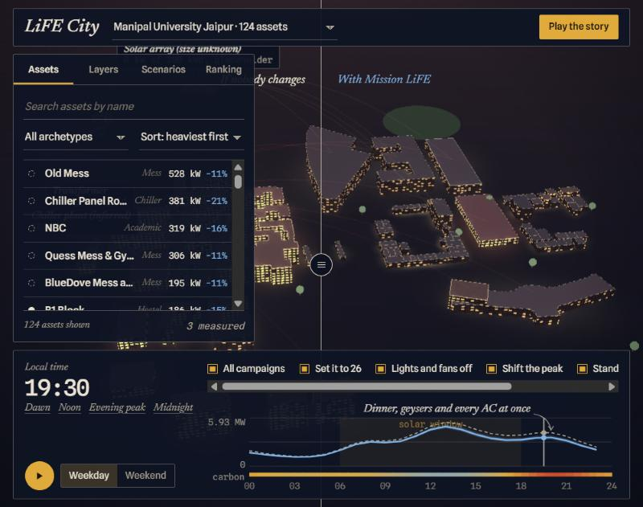
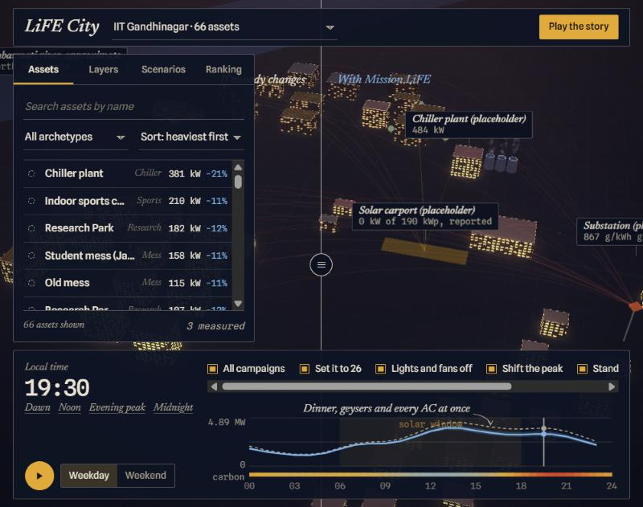

# LiFE City

A 3D energy control room for two campuses, built around India's Mission LiFE. Scrub through a day and watch buildings
light up in proportion to their load. Switch Mission LiFE campaigns on and compare a campus where nobody changes with
one where everyone does, side by side.

HackCult '26, IIT Gandhinagar. Track 1: Green Energy and Sustainability.





## Status: read this first

This is a **front-end prototype**. It runs entirely in the browser.

- There is no backend, database, authentication or deployed API. The service design in
  [docs/architecture.md](docs/architecture.md) (section 2) is a plan, and none of it is built.
- Every load is **modelled** from building-type profiles. There is no meter data. The six buildings drawn as "measured"
  are demo flags that show the styling.
- Positions are real (OpenStreetMap). Manipal University Jaipur has real footprints. IIT Gandhinagar buildings are
  boxes at their real positions. **Heights, uses, loads, tariff, carbon curve and campaign effects are placeholders.**
- The System tab (latency, retry queue, outage toggle) is simulated, and says so on screen.
- History: first built on 22 October 2026, before the HackCult sprint window opened (23 October, 6:30 PM IST). It was
  split into files, given checks and published on 25 October 2026 in an earlier repository, then moved here on 27 October 2026.

[docs/data-and-sources.md](docs/data-and-sources.md) lists what is real, what is a placeholder, and where each number came from.

## Run it

You need a browser with WebGL and an internet connection (three.js loads from jsDelivr and the fonts from Google Fonts).

```bash
git clone https://github.com/chiragshah2357/IIT-Gandhinagar-HackCult.git
cd IIT-Gandhinagar-HackCult
python -m http.server 8080 --directory web
```

Then open <http://localhost:8080> for the landing page. The control room is at <http://localhost:8080/app/>. Any static file server works; there is no build step.

## Using it

- **Campus dropdown** (top left): both campuses in one scene, or either one on its own. Every number, the ranking and
  the citizen view follow the choice.
- **Time**: drag on the load chart, press Space to play the day, or use the Dawn, Noon, Evening peak and Midnight presets.
  Lit windows follow each building's load. Roof and ground colour follow the grid's carbon at that hour, clean blue to
  ochre to madder.
- **Campaigns**: five Mission LiFE energy campaigns along the dock (keys 1 to 5). The divider splits the screen into
  "If nobody changes" and "With Mission LiFE"; drag its handle to compare.
- **Left panel**: Assets (search, filter, sort 190 buildings), Layers, Scenarios (save a combination), Ranking
  (neighbourhoods scored by what they saved times who takes part).
- **Right panel**: Inspector (click a building), Citizen (one resident's phone view), Add building, System, Events.
- **Add building** inserts a new row into the registry, simulates only that building and appends it to the graphics
  buffer. Its scale test adds hundreds of generated buildings the same way and reports measured timings.
- **Play the story** runs a short scripted tour.
- `app/?embed=1&campus=mujaipur` plays the scene alone, with no interface, looping a day. The landing page uses it
  behind its headline.

Other keys: left and right arrows scrub time, Esc lets go of a selection.

## Repository layout

```
web/
  index.html            landing page: the problem, the idea, the system, how it was planned
  landing/              the landing page's styles, script and screenshots
  app/
    index.html          the control room's markup
    styles.css          styles
    app.js              registry, simulation, rendering and UI, in ruled sections
    data/assets.js      seed table: 190 buildings (IITGN 66, MUJ 124)
scripts/check.mjs       static checks (syntax, local references, in-page anchors, pinned CDN scripts, asset table shape)
docs/               architecture, data and sources, screenshots
```

## Checks

```bash
npm ci
npm test
```

`npm test` runs `scripts/check.mjs` and a Prettier format check. The same two steps run in GitHub Actions on every pull
request. They do not open a browser; the app itself was exercised by hand in one.

## How it is put together

The design principle is that the world is data and the code only knows kinds. A building, a building type and a campaign
are each a row in a table, so adding a building or a whole campus needs no code change. The per-building simulation is a
pure, memoised function, campus totals update by deltas, and each building's hourly load lives in a data texture so
scrubbing time changes one number rather than any geometry. See [docs/architecture.md](docs/architecture.md).

## Licence and attributions

Code: [MIT](LICENSE).

- Building positions and outlines in `web/app/data/assets.js` derive from OpenStreetMap, (c) OpenStreetMap contributors,
  under the [Open Database Licence](https://www.openstreetmap.org/copyright).
- [three.js](https://threejs.org) r128 (MIT) is loaded from jsDelivr with pinned versions and integrity hashes.
- Spline Sans, Spline Sans Mono and Newsreader are loaded from Google Fonts (SIL Open Font Licence).
