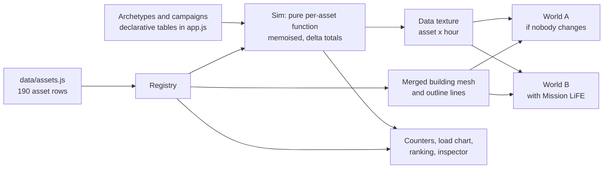
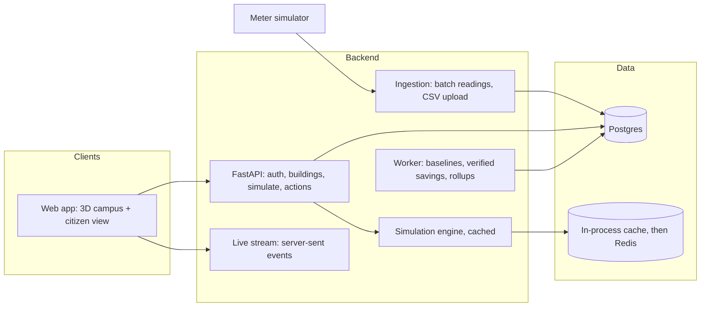
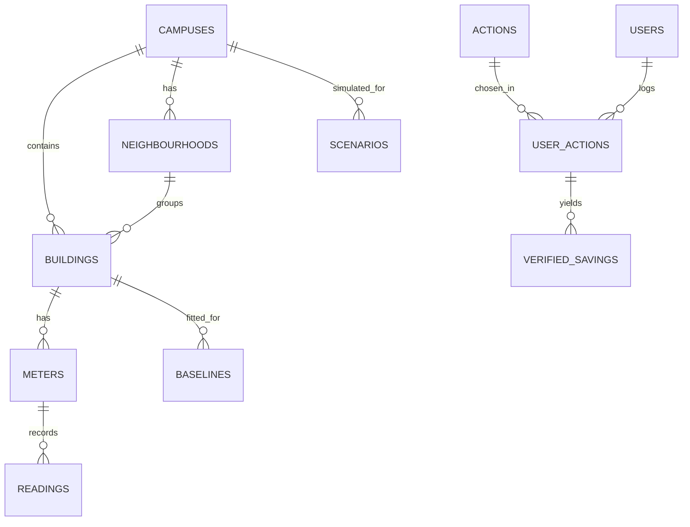

# Architecture

Two parts: what is in this repo today, and the system it is designed to grow into. Keep them apart when you read
this. **Section 1 is built. Section 2 is a design and none of it is implemented.**

## 1. What is built: a static front end

Everything runs in the browser. There is no server, database, authentication or deployed API.

### Principle: the world is data, code only knows kinds

A building is a row, a building type is a row, a campaign is a row. Nothing in the code names a specific building.

| Change                | How it is added                                                    | What recomputes                          | Code change |
| --------------------- | ------------------------------------------------------------------ | ---------------------------------------- | ----------- |
| New building          | Insert a registry row (the **Add building** tab does exactly this) | That building only; campus totals by delta | None        |
| New building type     | Add an archetype to `ARCH` (label, kW density, component mix, shapes) | Buildings of that type                   | None        |
| New Mission LiFE campaign | Add an entry to `CAMP` (target kinds, component, low/mid/high cut, time profile) | Scenario totals, lazily        | None        |
| New campus            | Add a campus to `CAMPS` and rows tagged with its `campus` id       | That campus                              | None        |
| Renovation            | Bump the asset's `rev`                                             | Only that asset's cache entry            | None        |

The second campus was added exactly this way: Manipal University Jaipur is 124 rows in `data/assets.js` plus one entry
in `CAMPS`.

### Where things live in `web/app/app.js`

`app.js` is one file with ruled section comments. In order:

1. **Context and environment**: time, day type, campaign mask, selected campus; the modelled grid-carbon and sun curves.
2. **Model library**: `ARCH` (11 archetypes with four load components: cooling, lighting, plug, hot water), `SH`
   (hourly shapes), `CAMP` (5 campaigns).
3. **Asset registry**: the single source of truth for what exists.
4. **Sim**: a pure function of (asset, revision, campaign mask, day type). Results are memoised per asset in a bounded
   cache, and campus totals are kept by deltas, so adding one building touches one building.
5. **GPU buffers (`Shared`)**: per-building load for each hour sits in a float data texture (width = capacity,
   height = 24). Scrubbing time changes one uniform, not geometry. Buffers double when capacity is exceeded.
6. **Shaders**: lit windows brighten in proportion to load, the roof and ground wash take the carbon colour
   (clean blue to ochre to madder), outlines are dashed for modelled assets.
7. **`World`**: one scene per view. The ghost-campus split is two worlds on two canvases (baseline on the left,
   campaigns on the right) cut by a CSS clip-path at a draggable divider.
8. **Boot, event log, simulated telemetry**, camera, picking and placement, labels.
9. **UI**: asset list (virtualised), layers, scenarios, ranking, citizen view, inspector, add building and scale test,
   system and events panes, the load chart, the scripted "Play the story" tour.

### Multi-campus

Every asset carries a `campus` id and every aggregate is filtered by it (`Sim.totals(mask, day, campus)`), so
the campus dropdown is a tenant filter, not a second app. The two campuses sit in one 3D scene, 1,700 m apart.

### What the prototype measures about itself

The **Add building** tab has a scale test (+100, +500, +2,000 generated buildings through the same path as a real
one). It reports, measured live in the page: registry insert time, incremental simulation for the new rows, the cost
of "one more building from here" against "starting over for the same scenario", graphics upload time and the
data-texture size. One run on 25 Oct 2026, adding 500 buildings to the 190 seeded (690 in total) in the Claude desktop
app's software-rendered browser pane:

| Measure                                  | Result   |
| ---------------------------------------- | -------- |
| 500 rows into the registry               | 8.1 ms   |
| Simulation for the new rows, one scenario | 35.0 ms  |
| One more building from here              | 0.58 ms  |
| Starting over, same scenario             | 101 ms   |
| Graphics upload                          | 3.6 ms   |
| Data texture                             | 1,024 slots, grown from 256 |

That is a single run on a slow renderer, not a benchmark. It supports one claim only: the cost of a change follows
what changed, not the size of the campus. The data texture is capped at 4,096 assets; beyond that the design is to tile
by area with level of detail.

### What is simulated and what is not

The **System** tab (service latency, readings per second, retry queue, database connections, worker lag), the
"Simulate database outage" toggle and the event feed are generated in the page to show the design. The page labels
them as simulated. Loads, the carbon curve, tariff and campaign effects are modelled; see
[data-and-sources.md](data-and-sources.md).

## 2. Target architecture (planned, not built)

The intended system keeps this front end and puts a real service behind it, so that a judge's input at a booth changes
the campus.

| Piece       | Choice                                                         |
| ----------- | -------------------------------------------------------------- |
| API         | FastAPI, Pydantic v2, SQLAlchemy 2, Alembic                    |
| Database    | Postgres, `campus_id` as the tenant key                        |
| Cache       | In-process first, Redis later                                  |
| Simulation  | The model in `app.js`, ported to a server-side pure function    |
| Web         | This front end, with the typed API client generated from OpenAPI |
| Quality     | pytest, ruff, mypy, Playwright smoke test, a measured load test, CI |

Resilience behaviours the design calls for: `/healthz` and `/readyz`; a degraded mode that serves the last cached
snapshot when the database or cache is down (the prototype's outage toggle shows what the user would see);
idempotent ingestion keyed by a client-supplied key; timeouts, retries and a cached fallback on external calls;
rate and size limits; validation on every input.

### Data model

`readings` is unique on `(meter_id, ts)` and partitioned by month. Buildings carry a data-confidence flag (measured or
modelled) so that coverage grows honestly as real readings arrive.

### API surface

| Method and path                                    | Purpose                                                |
| -------------------------------------------------- | ------------------------------------------------------ |
| `POST /auth/register`, `/auth/login`, `/auth/refresh` | Short-lived JWT access tokens                         |
| `GET /campuses/{id}/buildings`                     | Footprints, types, data-confidence flag                |
| `GET /buildings/{id}/load`                         | Time series with `from`, `to`, `resolution`            |
| `POST /readings:batch`                             | Idempotent batch ingestion (`Idempotency-Key` header)  |
| `POST /scenarios/simulate`                         | Campaigns and participation in, hourly loads out, cached by parameter hash |
| `GET /actions`, `POST /me/actions`                 | The Mission LiFE energy action catalogue, and logging an action |
| `GET /leaderboard`                                 | Neighbourhoods, scored fairly against their own baseline |
| `GET /healthz`, `/readyz`, `/metrics`              | Operations                                             |

Performance numbers will only be quoted once they are measured on a deployed instance.

### Scale-out story

Stateless API containers behind a load balancer; `readings` partitioned by month with read replicas for dashboards;
Redis for hot simulation results; a queue and workers for baselines and rollups; `campus_id` as the shard key; static
assets on a CDN. The first deployment is a single node, and anything beyond it is labelled as design.
